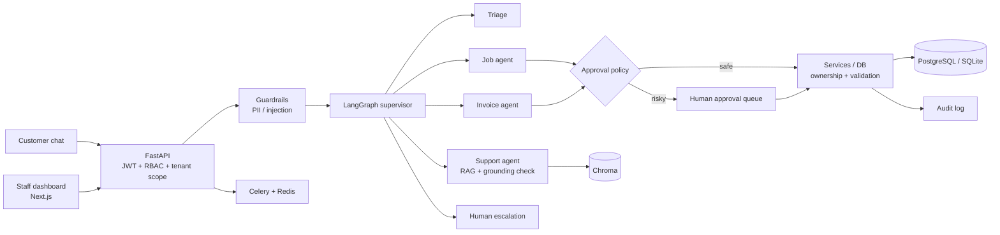

<div align="center">

# Helpdesk AI Agent

**A multi-tenant, production-minded AI helpdesk for field-service companies (HVAC, boiler, electrical).**

Supervisor + specialist LangGraph agents, RAG with a grounding check, human-in-the-loop approvals, and security enforced *below* the LLM.


</div>

<!-- Add screenshots here: customer chat, staff dashboard, approvals queue.
     e.g.  -->

## Why it matters

Most LLM demos let the model call tools directly. This project treats the **LLM as an untrusted decision component**: authorization, ownership checks, validation, approvals and persistence are enforced in deterministic code *below* the agent layer, so a prompt-injected or hallucinating model cannot exceed what the caller is allowed to do. See [docs/production-helpdesk-architecture.md](docs/production-helpdesk-architecture.md).

## Key features

- **Multi-agent orchestration**: LangGraph supervisor routes to Support, Job, Invoice and Human-Escalation specialists, with a triage step.
- **RAG with grounding self-check**: Chroma-backed knowledge base; answers are verified against retrieved context.
- **Human-in-the-loop approvals**: risky actions are paused at an approval gate (`src/agents/approval_policy.py`, `src/hitl/`) until a human approves.
- **Multi-tenant + 5-role RBAC**: `PLATFORM_ADMIN`, `TENANT_ADMIN`, `SUPPORT_AGENT`, `AI_AGENT`, `CUSTOMER`, with JWT auth and tenant isolation.
- **Guardrails**: PII redaction and prompt-injection detection (`src/guardrails/`).
- **Audit logging** of sensitive actions.
- **Persistent conversations**: LangGraph checkpoints via `PostgresSaver` / `SqliteSaver`.
- **Background work**: Celery + Redis workers.
- **ML ticket classifier** (scikit-learn) and an **MCP server** (`mcp_server/`).
- **Next.js staff dashboard + customer chat UI**.

## Architecture



## Tech stack

| Layer | Technology |
|---|---|
| API | Python 3.11, FastAPI, Pydantic |
| Agents | LangGraph, LangChain |
| Retrieval | Chroma (RAG) |
| Data | SQLAlchemy, Alembic, PostgreSQL (prod) / SQLite (dev) |
| Async | Celery, Redis |
| ML | scikit-learn |
| Integration | MCP server |
| Frontend | Next.js 16, React 19, Tailwind 4 |
| Quality | pytest, ruff, pre-commit, GitHub Actions, Docker |

## Repository structure

```
src/
  api/          FastAPI routers (auth, tickets, jobs, chat, approvals, ...)
  agents/       Supervisor, specialists, triage, approval policy
  hitl/         Human-in-the-loop approval service and graph gate
  guardrails/   PII redaction, prompt-injection checks
  rag/          Retrieval pipeline
  auth/ core/   JWT, RBAC, settings
  db/ services/ Persistence and business logic
  workers/      Celery app and tasks
  ml/           Ticket classifier training
mcp_server/     MCP server and client
alembic/        Database migrations
db/             Schema and seed script
eval/           Golden dataset, adversarial cases, PromptFoo + LangSmith runners
frontend/       Next.js app
tests/          pytest suite
docs/           Architecture doc and detailed reference
```

## Quickstart

Requires Python 3.11+, Node.js (for the frontend), and an OpenAI-compatible LLM API key.

### Backend

```bash
python -m venv .venv
source .venv/bin/activate        # Windows: .venv\Scripts\activate
pip install -r requirements.txt

cp .env.example .env             # set LLM_API_KEY and JWT_SECRET_KEY (required)

python db/seed.py                # creates db/helpdesk.sqlite3 with mock data
alembic upgrade head             # apply ORM migrations
uvicorn src.api.main:app --reload
```

API docs (Swagger) are at <http://localhost:8000/docs>. Create a user via `POST /auth/register`, then authenticate with `POST /auth/login`.

Optional worker: `celery -A src.workers.celery_app worker --loglevel=info` (needs Redis).

### Frontend

```bash
cd frontend
npm install
npm run dev                      # http://localhost:3000
```

The UI calls `http://localhost:8000` by default; override with `NEXT_PUBLIC_API_URL`.

### Docker

```bash
docker build -t helpdesk-ai-agent .
docker run --env-file .env -p 8000:8000 helpdesk-ai-agent
```

## API overview

| Router | Prefix | Purpose |
|---|---|---|
| auth | `/auth` | Register, login (JWT) |
| users | `/users` | User management (admin) |
| tickets | `/tickets` | Support tickets |
| jobs | `/jobs` | Field-service jobs |
| customers / engineers | `/customers`, `/engineers` | Directory data |
| invoices | `/invoices` | Billing |
| chat | `/chat` | Agent conversations |
| approvals | `/approvals` | Human approval queue |
| knowledge | `/knowledge` | RAG knowledge base |
| ai-config | `/ai-config` | Per-tenant agent configuration |
| audit-logs | `/audit-logs` | Audit trail |
| dashboard | `/dashboard` | Aggregated metrics |

## Security and safety

- **RBAC**: five roles; endpoints enforce role checks and prevent privilege escalation.
- **Tenant isolation**: `tenant_id` is derived from the authenticated principal, never from the request body or the model.
- **Human approval gate**: risky agent actions require explicit human approval before execution.
- **Guardrails**: PII redaction and prompt-injection detection on agent input.
- **Audit logs**: approvals and sensitive actions are recorded.
- **Secrets**: `.env` is git-ignored; `JWT_SECRET_KEY` has no default.

## Testing and evaluation

```bash
pytest          # ~610 test functions under tests/
ruff check .
```

A GitHub Actions workflow ([.github/workflows/ci.yml](.github/workflows/ci.yml)) runs ruff, pytest and a Docker build. The `eval/` directory holds a golden dataset, adversarial cases, and PromptFoo / LangSmith runners (see [eval/README.md](eval/README.md)).

## Roadmap

- [ ] Docker Compose for API + Postgres + Redis + frontend
- [ ] Screenshots and a short demo recording
- [ ] Streaming chat responses in the UI
- [ ] Expanded eval coverage and CI-gated eval thresholds

## More documentation

The original day-by-day build notes and detailed setup are preserved in [docs/REFERENCE.md](docs/REFERENCE.md).
